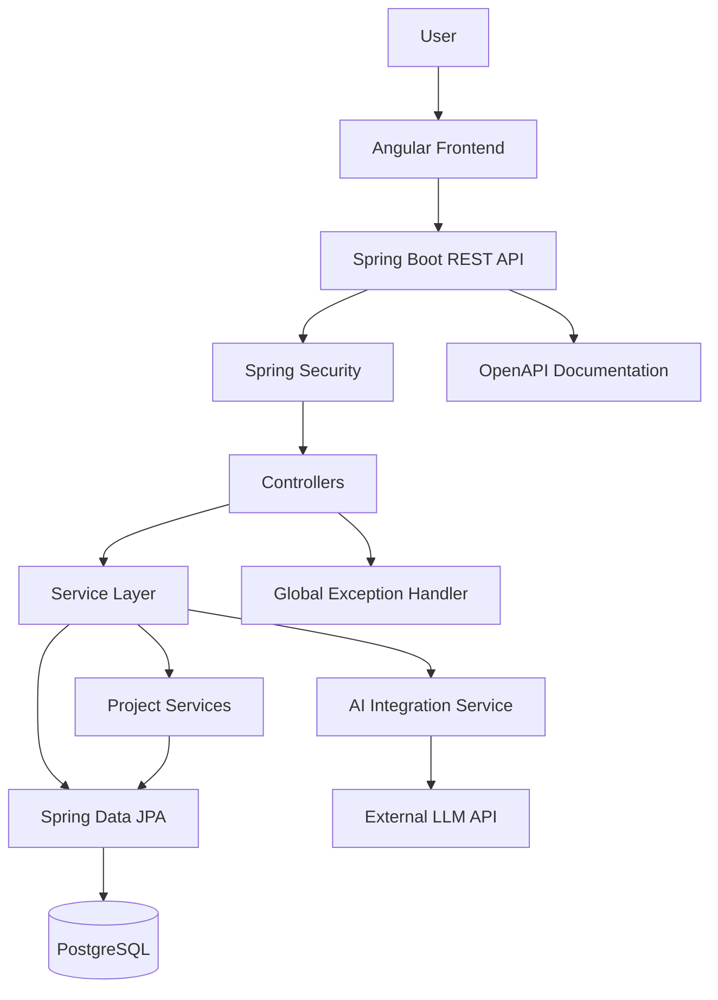
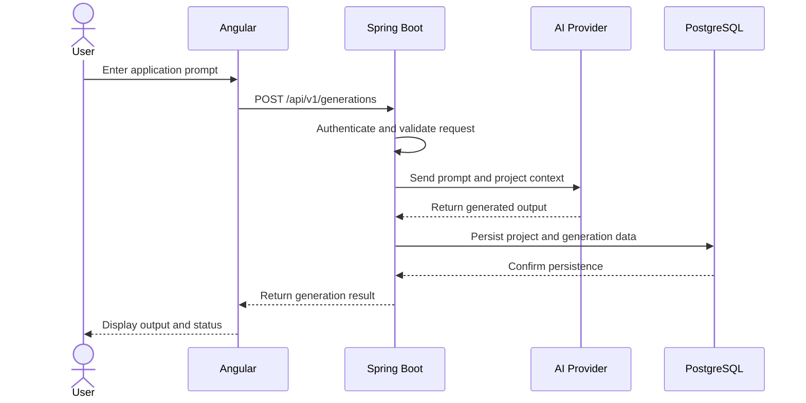
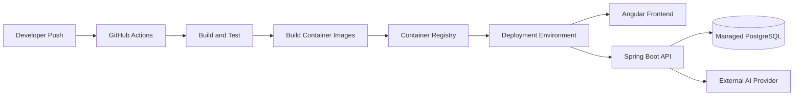

# 🚀 Buildora — AI-Powered Full-Stack Application Builder

### From natural language prompts to full-stack applications.

Buildora is an AI-powered web application builder inspired by platforms like Lovable AI. It aims to simplify application development by allowing users to describe their requirements in natural language and transform their ideas into structured, functional web applications.

Built with **Angular, Spring Boot, and AI integration**, Buildora explores how modern frontend frameworks, enterprise-grade backend architecture, and large language models can work together to accelerate software development.

> **Build smarter. Develop faster. Ship ideas.**

---

## 📌 Table of Contents

- [Overview](#-overview)
- [Key Features](#-key-features)
- [Technology Stack](#-technology-stack)
- [System Architecture](#-system-architecture)
- [Application Workflow](#-application-workflow)
- [Project Structure](#-project-structure)
- [Getting Started](#-getting-started)
- [Environment Configuration](#-environment-configuration)
- [API Design](#-api-design)
- [Security](#-security)
- [Database Design](#-database-design)
- [Testing](#-testing)
- [Deployment](#-deployment)
- [Engineering Practices](#-engineering-practices)
- [Roadmap](#-roadmap)
- [Contributing](#-contributing)
- [License](#-license)

---

## 🌟 Overview

Traditional web application development requires developers to work across UI design, frontend components, backend APIs, database integration, and deployment.

Buildora aims to streamline this workflow through an AI-assisted development environment.

Users can describe an application, refine requirements through conversational prompts, and work toward generating, previewing, and managing application code from a unified interface.

### The Vision

- **For beginners:** Make application development more accessible.
- **For developers:** Accelerate prototyping and repetitive development tasks.
- **For teams:** Explore AI-assisted application development with a structured backend architecture.
- **For builders:** Reduce the time between an idea and a working prototype.

---

## ✨ Key Features

The following describes the intended product capabilities. Mark a feature as implemented only when it is working in the current version.

### 🤖 AI-Powered Application Generation

- Convert natural language prompts into application requirements.
- Generate code using an integrated large language model.
- Support iterative improvements through follow-up instructions.
- Maintain project context across development conversations.

### 💻 Development Workspace

- Manage multiple application projects.
- Organize generated files and source code.
- Inspect and edit generated code.
- Preview generated applications in an isolated environment.

### 🎨 Modern Angular Interface

- Responsive application dashboard.
- Component-based UI architecture.
- Reusable Angular components and services.
- Reactive forms and client-side validation.
- Loading indicators, error handling, and user feedback.

### ⚙️ Spring Boot Backend

- RESTful APIs for application functionality.
- Layered architecture with controllers, services, and repositories.
- Request validation and centralized exception handling.
- Persistent storage for users, projects, and related resources.
- Integration with AI services through dedicated service components.

### 🔐 Authentication and Authorization

- User registration and login.
- Token-based authentication.
- Role-based access control where required.
- Protection of user-specific projects and resources.

### 🚀 Deployment-Oriented Design

- Environment-specific configuration.
- Containerized services with Docker.
- Database migration management.
- Automated build and test pipelines.
- Production deployment support.

---

## 🛠️ Technology Stack

| Layer             | Technology                              | Responsibility                             |
| ----------------- | --------------------------------------- | ------------------------------------------ |
| Frontend          | Angular, TypeScript                     | User interface and client-side application |
| UI Styling        | Angular Material / CSS                  | Responsive design and UI components        |
| Backend           | Java, Spring Boot                       | Business logic and REST APIs               |
| API Security      | Spring Security                         | Authentication and authorization           |
| Authentication    | JWT or secure session-based auth        | Identity and access management             |
| ORM               | Spring Data JPA, Hibernate              | Persistence and entity mapping             |
| Database          | PostgreSQL                              | Persistent relational storage              |
| Schema Management | Flyway or Liquibase                     | Versioned database migrations              |
| AI Integration    | Gemini API or another LLM provider      | Prompt processing and code generation      |
| API Documentation | OpenAPI / Swagger                       | API exploration and documentation          |
| Testing           | JUnit 5, Mockito, Angular testing tools | Automated testing                          |
| Build Tools       | Maven, npm                              | Backend and frontend dependency management |
| DevOps            | Docker, Docker Compose                  | Containerization and local orchestration   |
| CI/CD             | GitHub Actions                          | Automated checks and delivery              |
| Version Control   | Git, GitHub                             | Collaboration and source management        |

*This is the recommended stack for the project. Keep only technologies that your repository actually uses in the implemented-stack section.*

---

## 🏗️ System Architecture

Buildora follows a layered, API-driven architecture that separates presentation, business logic, persistence, and external AI integration.



### Architecture Responsibilities

**Angular frontend**

- Displays the development workspace and project dashboard.
- Sends HTTP requests through Angular services.
- Handles navigation, form validation, and application state.
- Displays generation status and errors.

**Spring Boot backend**

- Validates incoming requests.
- Applies business rules and authorization.
- Coordinates project management and AI generation.
- Persists application data through Spring Data JPA.
- Returns consistent API responses.

**AI integration layer**

- Builds prompts from user instructions and project context.
- Communicates with the selected model provider.
- Handles provider errors, timeouts, and response validation.
- Converts model output into a format the application can process.

**PostgreSQL**

- Stores persistent project and user data.
- Supports relational integrity and transaction management.
- Uses schema migrations for controlled database changes.

---

## 🔄 Application Workflow



For long-running generation jobs, use a background job model with a job identifier and polling or server-sent events rather than keeping an HTTP request open indefinitely.

---

## 📂 Project Structure

A suggested monorepo layout:

```text
buildora/
│
├── frontend/                         
│   ├── src/
│   │   ├── app/
│   │   │   ├── core/                
│   │   │   ├── shared/               
│   │   │   ├── features/
│   │   │   │   ├── auth/
│   │   │   │   ├── dashboard/
│   │   │   │   ├── projects/
│   │   │   │   └── workspace/
│   │   │   └── app.routes.ts
│   │   └── environments/
│   ├── package.json
│   └── angular.json
│
├── backend/                          
│   ├── src/
│   │   ├── main/
│   │   │   ├── java/
│   │   │   │   └── com/buildora/
│   │   │   │       ├── config/
│   │   │   │       ├── security/
│   │   │   │       ├── controller/
│   │   │   │       ├── service/
│   │   │   │       ├── repository/
│   │   │   │       ├── entity/
│   │   │   │       ├── dto/
│   │   │   │       ├── mapper/
│   │   │   │       ├── exception/
│   │   │   │       └── ai/
│   │   │   └── resources/
│   │   │       ├── application.yml
│   │   │       └── db/migration/
│   │   └── test/
│   ├── pom.xml
│   └── Dockerfile
│
├── docker-compose.yml
├── .github/
│   └── workflows/
├── .gitignore
├── .env.example
└── README.md
```

This structure is a reference architecture; adapt package names and folders to the actual codebase.

---

## ⚙️ Getting Started

### Prerequisites

Install the following tools before running Buildora:

- Java JDK compatible with the Spring Boot version used by the project.
- Maven, or the project's Maven Wrapper.
- Node.js version supported by your Angular version.
- npm.
- PostgreSQL.
- Git.
- An API key for your selected AI provider, if AI generation is enabled.

### 1. Clone the Repository

```bash
git clone <YOUR_REPOSITORY_URL>
cd buildora
```

### 2. Configure the Backend

Navigate to the backend directory:

```bash
cd backend
```

Configure the required database and AI provider settings using environment variables or a local, uncommitted configuration file.

Start the Spring Boot application:

```bash
./mvnw spring-boot:run
```

On Windows:

```powershell
mvnw.cmd spring-boot:run
```

### 3. Configure the Frontend

Open another terminal:

```bash
cd frontend
npm install
```

Start Angular:

```bash
npm start
```

If the project does not define an `npm start` script, use the configured Angular CLI command:

```bash
npx ng serve
```

Open the local URL printed in the terminal, commonly `http://localhost:4200`.

### 4. Verify the Application

Confirm that:

- The Angular application loads.
- The Spring Boot backend starts successfully.
- The database connection is working.
- The frontend can reach the backend API.
- AI features work when the required provider credentials are configured.

---

## 🔑 Environment Configuration

Use environment variables to configure credentials and environment-specific settings.

Example `.env.example`:

```env
# Database
DB_URL=jdbc:postgresql://localhost:5432/buildora
DB_USERNAME=buildora_user
DB_PASSWORD=change_me

# AI provider
GEMINI_API_KEY=replace_with_your_key

# Backend
SERVER_PORT=8080
```

These names are examples; map them to the properties actually read by the application.

Example Spring Boot configuration:

```yaml
spring:
  datasource:
    url: ${DB_URL}
    username: ${DB_USERNAME}
    password: ${DB_PASSWORD}

  jpa:
    hibernate:
      ddl-auto: validate

server:
  port: ${SERVER_PORT:8080}
```

For production, use a managed secrets store or your deployment platform's secret configuration. Do not commit real credentials, API keys, or production database passwords.

---

## 🌐 API Design

Buildora's backend should expose versioned REST endpoints with consistent response formats and validation.

Example API contract:

| Method | Endpoint                   | Purpose                              |
| ------ | -------------------------- | ------------------------------------ |
| POST   | `/api/v1/auth/register`    | Register a user                      |
| POST   | `/api/v1/auth/login`       | Authenticate a user                  |
| GET    | `/api/v1/projects`         | List the current user's projects     |
| POST   | `/api/v1/projects`         | Create a project                     |
| GET    | `/api/v1/projects/{id}`    | Retrieve a project                   |
| PUT    | `/api/v1/projects/{id}`    | Update a project                     |
| DELETE | `/api/v1/projects/{id}`    | Delete a project                     |
| POST   | `/api/v1/generations`      | Request AI generation                |
| GET    | `/api/v1/generations/{id}` | Retrieve generation status or result |

These are proposed endpoint contracts, not a claim that all routes currently exist.

### API Design Principles

- Use DTOs instead of exposing persistence entities directly.
- Validate request bodies with Jakarta Bean Validation.
- Return appropriate HTTP status codes.
- Use centralized exception handling.
- Enforce resource ownership and authorization on the backend.
- Document request and response schemas using OpenAPI.
- Add pagination to endpoints that return large collections.

---

## 🔐 Security

Security is essential when an application can generate and manage user code.

Recommended practices:

- Use Spring Security for authentication and authorization.
- Use secure, appropriately configured cookies or carefully managed tokens.
- Store passwords using a strong adaptive password-hashing algorithm.
- Validate all user input on the backend.
- Restrict cross-origin requests to approved frontend origins.
- Protect API keys and secrets using environment configuration.
- Enforce ownership checks for projects, files, and generation jobs.
- Apply request rate limits to expensive AI endpoints.
- Configure connection and request timeouts for external services.
- Avoid logging passwords, access tokens, API keys, and sensitive prompts.
- Run generated code only in isolated, resource-limited environments if execution is supported.

**Important:** Generating code and executing code are different capabilities. Never execute untrusted generated applications directly inside the main Spring Boot process or on the host without an appropriate isolation boundary.

---

## 🗄️ Database Design

PostgreSQL is a suitable relational database for managing Buildora's application data.

Potential entities include:

| Entity                | Responsibility                                    |
| --------------------- | ------------------------------------------------- |
| `User`                | User identity and account metadata                |
| `Project`             | Application name, owner, and metadata             |
| `Generation`          | Prompt, status, timestamps, and result references |
| `ProjectFile`         | Generated source files and version metadata       |
| `Conversation`        | Conversation context for a project                |
| `ConversationMessage` | User instructions and AI responses                |

### Database Engineering Practices

- Use foreign keys and appropriate indexes.
- Use transactions for related database operations.
- Store timestamps consistently, preferably in UTC.
- Apply schema changes through Flyway or Liquibase.
- Use DTOs and explicit mappings at the API boundary.
- Avoid storing large generated artifacts directly in database rows when object storage is more appropriate.
- Define retention and deletion policies for generated code and conversation data.

---

## 🧪 Testing

A reliable application should be tested across frontend, backend, database, and integration boundaries.

### Backend

- JUnit 5 for unit tests.
- Mockito for mocking dependencies.
- Spring Boot Test for application integration tests.
- Testcontainers for database-backed integration tests, if appropriate.
- Mock external AI providers in automated tests.

### Frontend

- Angular component and service tests.
- HTTP client tests for API integration.
- Form validation tests.
- End-to-end tests for important user journeys.

### Quality Checks

Before merging changes, aim to verify:

```bash
# Backend tests
cd backend
./mvnw verify

# Frontend tests
cd ../frontend
npm test
```

The exact commands depend on the project's configured build and test scripts.

---

## 🐳 Deployment

A production deployment can use Docker containers for the Angular web application, Spring Boot API, and supporting services.

Recommended deployment flow:



### Production Checklist

- [ ] Configure production database credentials.
- [ ] Use HTTPS for public endpoints.
- [ ] Configure allowed frontend origins.
- [ ] Externalize secrets.
- [ ] Apply database migrations.
- [ ] Configure health checks and graceful shutdown.
- [ ] Add structured logging and monitoring.
- [ ] Set limits and timeouts for AI requests.
- [ ] Configure backups and recovery procedures.
- [ ] Build and deploy immutable application artifacts.
- [ ] Test rollback and database migration procedures.

---

## 🧱 Engineering Practices

Buildora aims to follow industry-oriented software engineering principles:

- **Separation of concerns:** Keep controllers, services, repositories, and external integrations separate.
- **Clean API contracts:** Use versioned endpoints, DTOs, and consistent error responses.
- **Maintainability:** Prefer small, cohesive components and explicit dependencies.
- **Testability:** Cover business logic with automated tests.
- **Observability:** Use meaningful logs, health checks, and metrics.
- **Secure-by-design development:** Apply authentication, authorization, validation, and secret management from the beginning.
- **Scalable AI integration:** Isolate model-provider logic behind a service abstraction.
- **Reproducible builds:** Use dependency locking, Maven Wrapper, and documented setup steps.

---

## 🗺️ Roadmap

The following roadmap represents potential future development.

- [ ] Complete Angular dashboard and workspace.
- [ ] Implement authentication and user-specific projects.
- [ ] Build project creation and management APIs.
- [ ] Integrate an LLM provider through Spring Boot.
- [ ] Support multi-file code generation.
- [ ] Add generated-code preview.
- [ ] Implement conversational code refinement.
- [ ] Add project versioning and rollback.
- [ ] Introduce isolated execution for generated applications.
- [ ] Add automated code validation and repair.
- [ ] Implement Docker-based deployment workflows.
- [ ] Add CI/CD, observability, and production hardening.

---

## 🤝 Contributing

Contributions and suggestions are welcome.

1. Fork the repository.

2. Create a feature branch:

   ```bash
   git checkout -b feature/your-feature
   ```

3. Implement and test your changes.

4. Commit using a descriptive message:

   ```bash
   git commit -m "feat: add project management API"
   ```

5. Push your branch and open a pull request.

Please include relevant tests and update documentation when changing API contracts or configuration.

---

## 📄 License

Choose an appropriate open-source license and include the corresponding `LICENSE` file before publishing the project.

---

## 👨‍💻 About the Project

Buildora is an independent project exploring the intersection of full-stack engineering and AI-assisted software development.

It is inspired by the general concept of AI-powered application builders and is not affiliated with or endorsed by Lovable AI.

**Buildora — Turn your ideas into software.**

